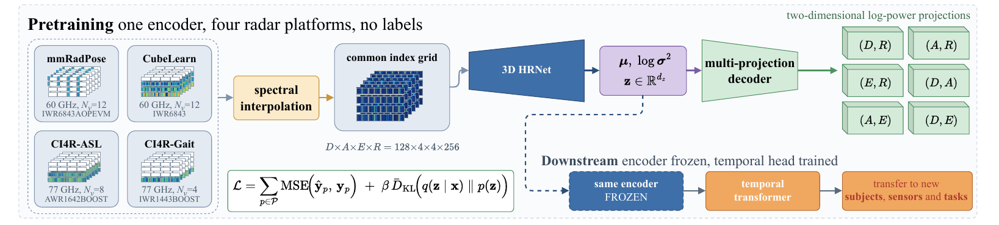

# A Universal Raw-IQ Radar Encoder for Cross-Sensor Human Sensing

Code for the WACV 2027 paper by Jonas Leo Mueller, Dario Zanca, Sebastian Hoefler, Jan Petermann,
Thomas Altstidl, Naga Venkata Sai Jitin Jami, Emmanuelle Salin and Bjoern M. Eskofier.



We pretrain a convolutional β-VAE on unlabeled raw radar IQ data from four platforms (60 and
77 GHz, 4 to 12 virtual antennas), mapped onto one common 128 × 4 × 4 × 256 grid. The encoder is
then frozen, and a small temporal head trained on its embeddings solves activity, gesture,
sign-language and gait recognition. This repository reproduces every number of our encoder in the
paper.

## Contents

1. [Install](#1-install)
2. [Check the paper numbers in one minute](#2-check-the-paper-numbers-in-one-minute)
3. [Datasets](#3-datasets)
4. [Pretraining data mixture](#4-pretraining-data-mixture)
5. [Reproduce our numbers](#5-reproduce-our-numbers)
6. [Expected results](#6-expected-results)
7. [Repository layout](#7-repository-layout)
8. [License and citation](#8-license-and-citation)

All commands are run from the repository root.

## 1. Install

```bash
git clone https://github.com/jonasmueler/UniversalRadarEncoder_WACV.git
cd UniversalRadarEncoder_WACV
python -m venv .venv && source .venv/bin/activate
pip install -e ".[data,weights,dev]"
python -m pytest tests          # CPU only, a few seconds, no data needed
```

Python 3.10 or newer and PyTorch 2 with CUDA. Pretraining needs one GPU with at least 40 GB of
memory (batch 16 on the full grid); the heads train on cached embeddings and run on any CUDA GPU.
`pip install -e ".[logging]"` adds Weights & Biases logging.

## 2. Check the paper numbers in one minute

`results/` holds the per-seed scores of every run of our encoders behind Tables 2 to 5. One command
recomputes each of our 43 table cells (mean ± sample standard deviation over seeds 0, 1 and 2) and
compares it with the printed value:

```bash
python -m frozenradar.aggregate --check
```

All 43 cells agree with the paper at three decimals. `tests/test_paper.py` additionally checks the
recipe, the pools, the splits and every number the text states about our encoder.

## 3. Datasets

None of the datasets is redistributed. Set `FR_DATA` to a directory with enough space and run the
preparation script of each dataset. Each script downloads the release, converts or unpacks it, and
checks the split against the manifest shipped in `splits/`.

```bash
export FR_DATA=/path/to/datasets
scripts/prepare_mmradpose.sh
scripts/prepare_cubelearn.sh
scripts/prepare_ci4r_asl.sh
scripts/prepare_ci4r_gait.sh
```

| Dataset | Radar | Source | Download | Benchmark split |
|---|---|---|---|---|
| mmRadPose | IWR6843AOPEVM, 60 GHz, 12 channels | [Zenodo 14738837](https://zenodo.org/records/14738837), CC BY-SA 4.0 | 66 GB | participants p4 to p11 train, p3 val, p1, p2, p12 test |
| CubeLearn | IWR6843, 60 GHz, 12 channels | [HuggingFace `zhaoymn/cubelearn`](https://huggingface.co/datasets/zhaoymn/cubelearn), Apache-2.0 | 45 GB | users 0 to 5 with the release's 15/5/10 sample split (in-set), users 6 and 7 (out-of-set) |
| CI4R-ASL | AWR1642BOOST, 77 GHz, 8 channels | [GCS bucket `asl_sequential_thms2021_dataset`](https://storage.googleapis.com/asl_sequential_thms2021_dataset) | 1.15 TB | 1496 repetitions, 1047/150/299, digest `d684d5a9125a4bd1` |
| CI4R-Gait | IWR1443BOOST, 77 GHz, 4 channels | [GCS `cross-frequency_dataset`](https://storage.googleapis.com/cross-frequency_dataset/Raw%20Data/raw_data.zip), 77 GHz members only | 24 GB | 652 recordings, 457/65/130, digest `a8d6e1becf5193ac`; leave-one-subject-out folds 0010, 0014, 0029, 0030 |

The scripts expect this layout under `$FR_DATA`:

```
mmRadPose_rawdata/   preprocessed/<recording>/radar/<t>.npy
cubelearn/           activity_organized/ hand_organized/ arm_organized/
ci4r_asl/            raw/ and processed/          ci4r_asl_store/   (train-only pretraining store)
ci4r_gait/raw/       <NN>_<activity>/*.bin        ci4r_gait_store/  (train-only pretraining store)
```

In code and configs, `ci4r` denotes CI4R-ASL and `multi3` denotes CI4R-Gait. Validation and test
units never enter a pretraining store, and every reader checks the store's digest.

## 4. Pretraining data mixture

Every encoder uses the recipe in `configs/pretrain/pool_base.yaml`: clutter removal, zero-filling
to the common grid, a four-dimensional FFT and per-frame RMS normalization; a 3D HRNet with a
two-layer transformer read-out, latent size 256, six log-power projection decoders, β = 0.1 with a
five-epoch warm-up, AdamW with a cosine schedule, batch 16, 50 epochs. Each epoch draws 169,000
frames with replacement from the pool, with a fixed share per dataset, so all encoders receive the
same number of optimisation steps. The share of CubeLearn is split evenly over its three tasks.

| Encoder | Config | Pool and shares | Used for |
|---|---|---|---|
| all sensors | `pool_mcag` | mmRadPose 1/4, CubeLearn 1/4, CI4R-ASL 1/4, CI4R-Gait 1/4 | rows "Raw-IQ VAE (all sensors)" |
| mmRadPose held out | `pool_cag` | CubeLearn, CI4R-ASL, CI4R-Gait, 1/3 each | mmRadPose "sensor held out" |
| CubeLearn held out | `pool_mag` | mmRadPose, CI4R-ASL, CI4R-Gait, 1/3 each | CubeLearn "sensor held out" |
| CI4R-ASL held out | `pool_mcg` | mmRadPose, CubeLearn, CI4R-Gait, 1/3 each | CI4R-ASL "sensor held out" |
| CI4R-Gait held out | `pool_mca` | mmRadPose, CubeLearn, CI4R-ASL, 1/3 each | CI4R-Gait "sensor held out" and the leave-one-subject-out table |

The head is a temporal transformer on the per-frame latent means: one layer on mmRadPose and
CubeLearn, four layers on CI4R, dropout 0.3, 200 epochs with label smoothing 0.1, selected on the
validation split and trained with seeds 0, 1 and 2 (`configs/downstream/`).

## 5. Reproduce our numbers

### a) With the released encoders and heads

The five encoders and all heads are on Google Drive (1.5 GB, listed with SHA256 checksums in
`weights_manifest.json`).

```bash
python -m frozenradar.download_weights ours        # into weights/ours/
python -m frozenradar.reproduce                    # needs the prepared datasets
python -m frozenradar.reproduce --pools pool_mcag --benchmarks mmradpose --seeds 0   # one cell
```

`reproduce` extracts embeddings with each released encoder, evaluates the released heads without
training, writes per-seed records to `reproduced/ours.jsonl` and compares every cell with the paper.

### b) From scratch

```bash
# 1. pretrain the five encoders (about 108 hours each on one A100 40 GB); outputs runs/pool_<p>/best.pt
for p in mcag cag mag mcg mca; do scripts/pretrain.sh $p; done

# 2. heads for the all-sensor encoder, seeds 0 to 2
E=runs/pool_mcag/best.pt; C=configs/pretrain/pool_mcag.yaml
for s in 0 1 2; do
  for t in har hgr agr; do scripts/eval_cubelearn.sh $E $C $t $s; done
  scripts/eval_mmradpose.sh $E $C $s
  scripts/eval_ci4r_asl.sh $E $C $s
  scripts/eval_ci4r_asl.sh $E $C $s hearing
  scripts/eval_ci4r_gait.sh $E $C $s
done

# 3. heads for the sensor-held-out encoders
for s in 0 1 2; do
  scripts/eval_mmradpose.sh runs/pool_cag/best.pt configs/pretrain/pool_cag.yaml $s
  for t in har hgr agr; do scripts/eval_cubelearn.sh runs/pool_mag/best.pt configs/pretrain/pool_mag.yaml $t $s; done
  scripts/eval_ci4r_asl.sh runs/pool_mcg/best.pt configs/pretrain/pool_mcg.yaml $s
  scripts/eval_ci4r_gait.sh runs/pool_mca/best.pt configs/pretrain/pool_mca.yaml $s
  for f in 0010 0014 0029 0030; do
    scripts/eval_ci4r_gait_loso.sh runs/pool_mca/best.pt configs/pretrain/pool_mca.yaml $s $f
  done
done

# 4. mean and standard deviation over seeds
scripts/aggregate.sh
```

Each evaluation script writes its log to `$FR_LOGS` (default `./logs`) and caches embeddings in
`$FR_CACHE` (default `./cache`). `--training.resume auto` continues an interrupted pretraining run.
Retrained encoders match the paper up to the run-to-run variation of GPU training, which is of the
order of the reported standard deviations.

## 6. Expected results

Accuracy, mean ± std over seeds 0, 1, 2, as printed in the paper (macro-F1 in `results/`).

| Benchmark | All sensors (`pool_mcag`) | Sensor held out |
|---|---|---|
| CubeLearn HAR in-set / out-of-set | 0.995 ± 0.006 / 0.930 ± 0.034 | 0.992 ± 0.012 / 0.877 ± 0.051 |
| CubeLearn HGR in-set / out-of-set | 0.980 ± 0.005 / 0.825 ± 0.005 | 0.957 ± 0.006 / 0.784 ± 0.015 |
| CubeLearn AGR in-set / out-of-set | 0.996 ± 0.006 / 0.905 ± 0.008 | 0.996 ± 0.003 / 0.956 ± 0.007 |
| mmRadPose | 0.880 ± 0.077 | 0.877 ± 0.016 |
| CI4R-ASL | 0.971 ± 0.007 | 0.967 ± 0.002 |
| CI4R-Gait | 0.951 ± 0.012 | 0.900 ± 0.020 |
| CI4R-Gait leave-one-subject-out, mean over folds | | 0.693 ± 0.012 |

## 7. Repository layout

```
frozenradar/            preprocessing, datasets, β-VAE, pretraining, head, evaluation
  aggregate.py          table check against the paper
  reproduce.py          evaluate the released encoders and heads
  download_weights.py   fetch and verify the released checkpoints
configs/                pretraining pools and head configs
scripts/                dataset preparation, pretraining, evaluation, aggregation
splits/                 CubeLearn sample split, CI4R manifests with digests
results/                per-seed scores of every run and the printed table values
tests/                  CPU tests, including the paper checks
```

## 8. License and citation

The code is released under the MIT license.

```bibtex
@inproceedings{mueller2027universal,
  title     = {A Universal Raw-IQ Radar Encoder for Cross-Sensor Human Sensing},
  author    = {Mueller, Jonas Leo and Zanca, Dario and Hoefler, Sebastian and Petermann, Jan and
               Altstidl, Thomas and Jami, Naga Venkata Sai Jitin and Salin, Emmanuelle and
               Eskofier, Bjoern M.},
  booktitle = {Proceedings of the IEEE/CVF Winter Conference on Applications of Computer Vision (WACV)},
  year      = {2027}
}
```
